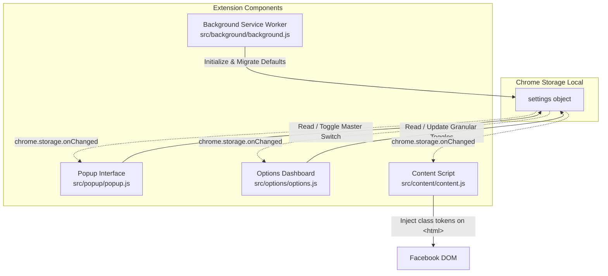

# ARCHITECTURE.md — Feature & Directory Map

Quick-reference map to help developers and AI assistants navigate features to their corresponding directory boundaries and understand core data flows.

---

## 1. Feature to Directory Index

| Feature / Domain | Directory | Primary Responsibility & Context |
| :--- | :--- | :--- |
| **Host DOM & Injected UI** | `src/content/` | Injected into Facebook (`https://www.facebook.com/*`); Zero-FOUC root class injector (`content.js`) and scoped declarative CSS hiding rules (`content.css`). |
| **Background Service Worker** | `src/background/` | Manifest V3 service worker (`background.js`); installation lifecycle & `DEFAULT_SETTINGS` initialization in `chrome.storage.local`. |
| **Toolbar Quick Panel** | `src/popup/` | Ephemeral browser action panel (`popup.html` / `popup.js` / `popup.css`); master ON/OFF toggle, section quick toggles (`trimTopNav`, `trimLeftItems`, `hoverExpandLeftRail`), jump to options. |
| **Extension Settings Page** | `src/options/` | Full-tab configuration center (`options.html` / `options.js` / `options.css`); granular toggles for Top Nav & Left Sidebar, section actions (`Recommended`, `Hide All`, `Show All`). |
| **Shared Foundations** | `src/shared/` | Cross-context utilities: state defaults (`defaults.js`), i18n localization helper (`i18n.js`). |
| **Localization Dictionaries** | `_locales/` | Native Chrome i18n dictionaries: English fallback (`_locales/en/messages.json`) and Traditional Chinese (`_locales/zh_TW/messages.json`). |
| **Icons & Brand Artwork** | `icons/`, `design/` | Production PNGs (`icons/`: 16, 32, 48, 128px) vs master SVG and design assets (`design/`). |
| **Release & Tooling** | `scripts/`, `tests/` | Packaging automation (`scripts/package.js`, `scripts/package.ps1`) and integrity unit tests (`tests/defaults.test.js`, `tests/test.ps1`). |

---

## 2. Context Boundaries & Storage Sync

All contexts communicate through `chrome.storage.local` with event-driven synchronization (`chrome.storage.onChanged`). No point-to-point messaging required for standard settings.



### Context Characteristics
- **Content (`src/content/`)**: Tied to web tab lifecycle (`https://www.facebook.com/*`). Executes at `document_start` before first paint. Injects CSS tokens onto `<html>` (`document.documentElement`) and monitors dynamic nodes via a debounced `MutationObserver`.
- **Popup (`src/popup/`)**: Ephemeral panel. Destroyed immediately when user clicks away. Changes are committed immediately to `chrome.storage.local`.
- **Options (`src/options/`)**: Dedicated browser tab. Full settings center for granular sidebar and navigation options.
- **Background (`src/background/`)**: Event-driven MV3 service worker. Ensures default values exist in `chrome.storage.local` on install or update.

---

## 3. Targeting & Injection Architecture

### Zero-FOUC Injection Strategy
1. Content script registered in `manifest.json` with `"run_at": "document_start"`.
2. Both `content.css` and `content.js` execute before DOM tree painting begins.
3. `content.js` queries `chrome.storage.local` immediately and applies CSS token classes directly to `document.documentElement` (`<html>`):
   ```javascript
   root.classList.toggle('fb-diet-hide-left-gaming', isEnabled);
   ```
4. `content.css` suppresses elements purely through declarative descendant selectors:
   ```css
   html.fb-diet-hide-left-gaming div[role="navigation"] a[href*="/gaming/"] {
     display: none !important;
   }
   ```
   This guarantees target elements are hidden prior to the browser's initial render frame.

### Dual-Layer Targeting: Static Selectors + Dynamic Scanner
Facebook uses compiled React components with dynamic, hashed classes (`.x193iq5w`).
- **Primary Layer (Attribute & URL Matching)**: Matches stable attributes such as `href*="/friends/"`, `href*="/marketplace/"`, SVG paths, or `aria-label`.
- **Secondary Layer (Dynamic Text Scanner)**: Lazy-loaded or dynamic items (e.g., **Ads Manager** nested under "See More") receive `.fb-diet-hide-left-ads-manager-node` via a throttled scanner (`requestAnimationFrame`) triggered by `MutationObserver`.
