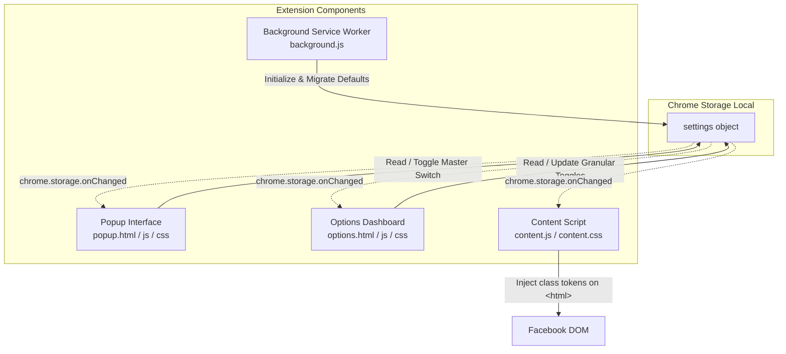

# Development Guide — FB Trim

This document covers the technical architecture, development workflow, state management, design system, and extension conventions for **FB Trim — Minimal Sidebar & Top Navigation**.

---

## 🛠️ Project Structure

```text
fb-trim-menu/
├── manifest.json              # Manifest V3 extension configuration (default_locale: en)
├── README.md                  # User-facing introduction & installation guide
├── DEVELOPMENT.md             # Technical architecture & development guide (this file)
├── AGENTS.md                  # AI behavioral contract & engineering discipline
├── _locales/                  # Internationalization string dictionaries
│   ├── en/messages.json       # English (default fallback)
│   └── zh_TW/messages.json    # Traditional Chinese
├── icons/                     # Extension branding icons (16, 32, 48, 128px)
├── design/                    # Raw design source assets (Affinity, SVG; NOT packaged)
├── scripts/                   # Release packaging tools (Zero npm dependencies)
│   ├── package.js             # Node.js release packager
│   └── package.ps1            # Windows PowerShell release packager
├── tests/                     # Integrity unit tests (Zero npm dependencies)
│   ├── defaults.test.js       # Node.js native test runner (node --test)
│   └── test.ps1               # Pure Windows PowerShell test runner
└── src/
    ├── background/
    │   └── background.js      # Service worker: installation & storage defaults initialization
    ├── content/
    │   ├── content.css        # Scoped CSS hiding rules keyed by root classes
    │   └── content.js         # Early root class applicator & dynamic item scanner
    ├── options/
    │   ├── options.html       # Granular settings dashboard (Top Nav & Left Sidebar)
    │   ├── options.css        # Options UI styling (dark frosted theme)
    │   └── options.js         # Settings manager, i18n renderer & section actions
    ├── popup/
    │   ├── popup.html         # Compact extension toolbar popup
    │   ├── popup.css          # Dark frosted theme & header toggle switch
    │   └── popup.js           # Master enable/disable toggle & options launcher
    └── shared/
        ├── defaults.js        # Single source of truth for default settings (DEFAULT_SETTINGS)
        └── i18n.js            # Shared i18n helpers (loadLocaleMessages / getMsg / applyI18n)
```

---

## 💻 Local Development Workflow

1. Clone or open this repository.
2. In Google Chrome, navigate to `chrome://extensions/`.
3. Enable **Developer mode** (toggle in the top-right corner).
4. Click **Load unpacked** (top-left) and select the `fb-trim-menu` repository root directory.
5. Making changes:
   - **Popup & Options changes**: Reopen the popup or reload the options page.
   - **Background service worker changes**: Click the reload/refresh icon on `chrome://extensions/`.
   - **Content script & CSS changes**: Click the reload icon on `chrome://extensions/` and reload the target Facebook tab (`https://www.facebook.com/*`).

---

## 🧪 Testing Strategy (`tests/`)

Unit testing ensures that configuration keys, toggle elements, and i18n localization dictionaries remain 100% synchronized with zero runtime dependencies.

```bash
# Using Node.js (Node 18+):
node --test tests/defaults.test.js

# Or on Windows using PowerShell:
powershell -ExecutionPolicy Bypass -File tests/test.ps1
```

- **Scope**: Verifies `DEFAULT_SETTINGS` type safety, bilingual dictionary parity (`en` <-> `zh_TW`), and input accessibility (`aria-label`).
- **Rule**: Do not add heavy browser automation frameworks (Puppeteer/Playwright).

---

## 📦 Packaging for Release (`scripts/`)

Packagers generate a clean release `.zip` in `release/fb-trim-v<version>.zip` excluding development documentation, tests, scripts, and git metadata:

```bash
# Using Node.js:
node scripts/package.js

# Or on Windows using PowerShell:
powershell -ExecutionPolicy Bypass -File scripts/package.ps1
```

---

## 🏗️ System Architecture



---

## ⚙️ Core Design Principles & Mechanisms

### 1. Zero-FOUC Injection Strategy

Traditional content scripts executing at `document_idle` suffer from Flash of Unstyled Content (FOUC), where unwanted navigation items flicker briefly before being hidden by JavaScript.

**FB Trim's Zero-FOUC Solution**:
1. `content_scripts` are registered in `manifest.json` with `"run_at": "document_start"`.
2. Both `content.css` and `content.js` are injected before DOM tree painting begins.
3. `content.js` queries `chrome.storage.local` immediately and applies CSS token classes directly to `document.documentElement` (`<html>`):
   ```javascript
   root.classList.toggle('fb-diet-hide-left-gaming', isEnabled);
   ```
4. `content.css` suppresses items purely through declarative descendant selectors:
   ```css
   html.fb-diet-hide-left-gaming div[role="navigation"] a[href*="/gaming/"] {
     display: none !important;
   }
   ```
This guarantees target elements are invisible prior to the browser's first paint.

### 2. Dual-Layer Targeting: Static Selectors + Dynamic Scanner

Facebook heavily utilizes compiled React components with dynamic, obfuscated class names (e.g. `x193iq5w xeuugli`). Relying purely on static classes is inherently fragile.

FB Trim employs a dual-layer strategy:
1. **Primary Layer (Attribute & URL Matching)**:
   Matches persistent attributes such as `href*="/friends/"`, `href*="/marketplace/"`, SVG paths, or `aria-label` attributes.
2. **Secondary Layer (Dynamic Text Scanner)**:
   Asynchronous components like **Ads Manager** often load lazily under "See More" and embed dynamic or ambiguous URLs.
   - `content.js` executes a throttled DOM scanner (`triggerThrottledScan`) utilizing `requestAnimationFrame`.
   - A `MutationObserver` on `document.documentElement` triggers the scanner when new subtrees mount, avoiding layout thrashing.
   - Matched nodes receive the `.fb-diet-hide-left-ads-manager-node` class for CSS suppression.

---

## 📦 State & Storage Architecture

All state is persisted in `chrome.storage.local` under the `settings` key.

### Single Source of Truth (`src/shared/defaults.js`)

Default values are managed globally via `self.DEFAULT_SETTINGS`:

```javascript
self.DEFAULT_SETTINGS = {
  enabled: true,
  // Left Sidebar
  hideLeftProfile: false,
  hideLeftFriends: false,
  hideLeftFeeds: false,
  hideLeftMessenger: true,
  hideLeftGroups: false,
  hideLeftMarketplace: true,
  hideLeftReels: true,
  hideLeftMemories: true,
  hideLeftSaved: true,
  hideLeftPages: true,
  hideLeftEvents: true,
  hideLeftBirthdays: true,
  hideLeftGaming: true,
  hideLeftGamingVideo: true,
  hideLeftMetaAI: true,
  hideLeftAdsManager: true,
  hideLeftRecentAdActivity: true,
  hideLeftProfessionalDashboard: true,
  hideLeftMessengerKids: true,
  hideLeftMetaQuest: true,
  hideLeftFundraisers: true,
  hideLeftOrdersPayments: true,
  leftWidth: 360,
  // Top Navigation
  hideTopReels: false,
  hideTopMarketplace: true,
  hideTopGroups: false,
  hideTopGaming: true
};
```

### Real-Time Synchronization

- **Popup** and **Options**: Updating checkboxes immediately writes to `chrome.storage.local`.
- **Content Script & UI**: All active contexts listen to `chrome.storage.onChanged` to react dynamically without requiring page reloads:
  ```javascript
  chrome.storage.onChanged.addListener((changes, area) => {
    if (area === 'local' && changes.settings) {
      applyClasses(changes.settings.newValue || DEFAULT_SETTINGS);
    }
  });
  ```

---

## 🎨 UI/UX Design System

### Design Tokens (Dark Frosted Theme)

| Variable | Value | Purpose |
| :--- | :--- | :--- |
| `--bg-primary` | `#0e0e10` | Page backdrop |
| `--bg-card` | `#18181c` | Feature cards and panels |
| `--bg-card-hover` | `#222228` | Interactive card hover state |
| `--text-primary` | `#f0f0f2` | Primary headings and item titles |
| `--text-secondary`| `#909099` | Subtitles, status labels, and badge borders |
| `--divider` | `rgba(255, 255, 255, 0.08)` | Frosted glass borders |
| `--accent-color` | `#0ea5e9` | Action highlights, active switches |

### Interface Components

- **Popup (`src/popup/`)**:
  - Ultra-compact (`width: 250px`).
  - Master Enable/Disable switch integrated directly into the header.
  - Options launcher button.
- **Options Dashboard (`src/options/`)**:
  - Two structured sections: **Top Navigation** and **Left Sidebar**.
  - **Section-Level Quick Actions**: Right-aligned `Recommended`, `Hide All`, and `Show All` buttons scoped to that section's keys.
  - **Core Fixed Anchors**: Essential anchors (`Home`, `Profile`, `Feeds`) display `Always Shown` badges to prevent navigation breakage.
  - **Sidebar Width Slider**: Customizable navigation rail width (0–360px).

---

## 🌐 Internationalization (i18n)

FB Trim utilizes Chrome's native internationalization API (`chrome.i18n`) with support for:
- **English (`en`)**: Default fallback language (`"default_locale": "en"`).
- **Traditional Chinese (`zh_TW`)**: Aligned with Facebook's official regional terms.

### Shared i18n Helpers (`src/shared/i18n.js`)
- `loadLocaleMessages(locale)`: Fetches `_locales/<locale>/messages.json`.
- `getMsg(key)`: Looks up key in loaded dictionary or falls back to `chrome.i18n.getMessage(key)`.
- `applyI18n()`: Automatically hydrides elements with `[data-i18n]` and `[data-i18n-title]`.

---

## 🔧 Maintenance & Extending FB Trim

### Adding a New Item to Trim

1. **Add CSS rule in `src/content/content.css`**:
   ```css
   html.fb-diet-hide-left-newitem div[role="navigation"] a[href*="/newitem/"] {
     display: none !important;
   }
   ```

2. **Add default setting in `src/shared/defaults.js`**:
   ```javascript
   hideLeftNewItem: true // or false
   ```

3. **Add switch to `src/options/options.html`**:
   ```html
   <div class="feature-item">
     <div class="feature-meta">
       <span class="feature-icon">✨</span>
       <div class="feature-title" data-i18n="itemNewItem">New Item Name</div>
     </div>
     <label class="switch">
       <input type="checkbox" id="hideLeftNewItem" aria-label="Toggle New Item">
       <span class="slider round"></span>
     </label>
   </div>
   ```

4. **Add localized strings** in `_locales/en/messages.json` and `_locales/zh_TW/messages.json`.

5. **Verify class mapping**:
   `content.js` maps camelCase keys (e.g. `hideLeftNewItem`) to CSS class names (`fb-diet-hide-left-new-item`) via `getUiCleanClassName(key)`:
   ```javascript
   function getUiCleanClassName(key) {
     if (key === 'hideLeftMetaAI') return 'fb-diet-hide-left-metaai';
     return 'fb-diet-' + key.replace(/([A-Z])/g, '-$1').toLowerCase();
   }
   ```
