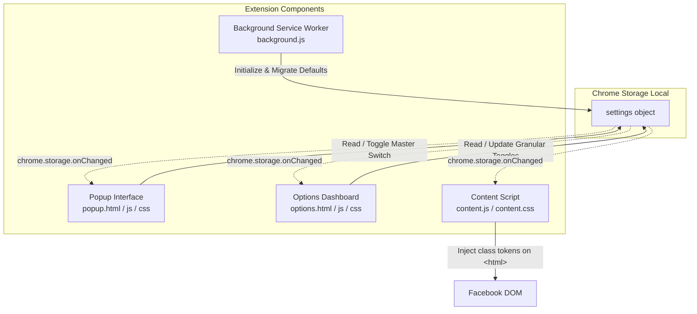

# Development & Architecture Documentation: FB Trim

This document details the internal design, architecture, performance strategies, styling system, and development guidelines for **FB Trim — Minimal Sidebar & Top Navigation**.

---

## 1. Project Overview

**FB Trim** is a lightweight, high-performance Google Chrome extension (Manifest V3) designed to eliminate visual clutter, unwanted algorithmic feeds, and distraction items from Facebook's desktop web interface (specifically the top navigation header and left sidebar).

### Core Goals
- **Zero Layout Shift (Zero-FOUC)**: Target elements are suppressed prior to the browser's first paint so unwanted sections never flicker on page load.
- **Pure CSS Execution**: Suppressions run via declarative CSS rules rather than continuous JavaScript element deletion, preserving CPU and memory.
- **Granular Control with Safe Anchors**: Critical navigation hubs (Home, Profile, Feeds, Messenger) remain permanently anchored, while all optional tabs provide independent switches.
- **Resilience**: Adaptive attribute and URL-based selectors resilient against Facebook's minified, dynamically generated class names.

---

## 2. System Architecture



### File Hierarchy

```text
fb-trim/
├── manifest.json              # Extension manifest (Manifest V3 with default_locale)
├── README.md                  # User-facing introduction & installation guide
├── Development.md             # Developer architecture & design documentation
├── _locales/                  # Internationalization string dictionaries
│   ├── en/messages.json       # English (default fallback)
│   └── zh_TW/messages.json    # Traditional Chinese
├── icons/                     # Extension branding icons (16, 32, 48, 128px)
└── src/
    ├── background/
    │   └── background.js      # Service worker: installation & storage migration
    ├── content/
    │   ├── content.css        # Scoped CSS hiding rules keyed by root classes
    │   └── content.js         # Early root class applicator & dynamic item scanner
    ├── options/
    │   ├── options.html       # Granular settings dashboard (Top Nav first, Left Sidebar second)
    │   ├── options.css        # Options UI styling (dark frosted theme)
    │   └── options.js         # Settings manager, i18n renderer & section actions
    ├── popup/
    │   ├── popup.html         # Compact extension toolbar popup
    │   ├── popup.css          # Dark frosted theme & header toggle switch
    │   └── popup.js           # Master enable/disable toggle & options launcher
    └── shared/
        ├── defaults.js        # Single source of truth for all default settings
        └── i18n.js            # Shared i18n helpers (loadLocaleMessages / getMsg / applyI18n)
```

---

## 3. Core Design Principles & Mechanisms

### 3.1 Zero-FOUC Injection Strategy

Traditional content scripts running at `document_idle` suffer from Flash of Unstyled Content (FOUC), where sidebars render momentarily before being hidden by JavaScript.

**FB Trim's Solution**:
1. `content_scripts` are registered with `"run_at": "document_start"`.
2. Both `content.css` and `content.js` are injected before any DOM nodes render.
3. `content.js` queries `chrome.storage.local` immediately and applies CSS token classes directly to `document.documentElement` (`<html>`):
   ```javascript
   root.classList.toggle('fb-diet-hide-left-gaming', isEnabled);
   ```
4. `content.css` hides items purely through descendant selectors:
   ```css
   html.fb-diet-hide-left-gaming div[role="navigation"] a[href*="/gaming/"] {
     display: none !important;
   }
   ```
This guarantees elements are invisible prior to their initial paint.

### 3.2 Dual-Layer Targeting: Static Selectors + Dynamic Scanner

Facebook heavily utilizes React with compiled, randomized class names (e.g. `x193iq5w xeuugli`). Static class targeting is inherently fragile.

FB Trim uses a dual-layer strategy:
1. **Primary Layer (Attribute & URL Matching)**:
   Matches persistent attributes such as `href*="/friends/"`, `href*="/marketplace/"`, SVG paths, or `aria-label` attributes.
2. **Secondary Layer (Dynamic Text Scanner)**:
   Asynchronous components like **Ads Manager** often load lazily under "See More" and embed ambiguous URLs.
   - `content.js` executes a throttled DOM scanner (`triggerThrottledScan`) utilizing `requestAnimationFrame`.
   - A `MutationObserver` on `document.documentElement` triggers the scanner whenever new subtrees are mounted without causing layout thrashing.
   - Nodes matching text identifiers (`廣告管理員`, `Ads Manager`) receive the `.fb-diet-hide-left-ads-manager-node` class.

---

## 4. State & Storage Architecture

All state is stored within `chrome.storage.local` under the `settings` key.

### Data Schema

```typescript
interface Settings {
  enabled: boolean;                      // Master switch

  // Top Navigation items (Home is always shown / fixed)
  hideTopReels: boolean;                 // default: false
  hideTopMarketplace: boolean;           // default: true (hidden)
  hideTopGroups: boolean;                // default: false
  hideTopGaming: boolean;                // default: true (hidden)

  // Left Sidebar items (Profile, Feeds, and Messenger are always shown / fixed)
  hideLeftFriends: boolean;              // default: false
  hideLeftGroups: boolean;               // default: false
  hideLeftMarketplace: boolean;          // default: false
  hideLeftReels: boolean;                // default: false
  hideLeftMemories: boolean;             // default: false
  hideLeftSaved: boolean;                // default: false
  hideLeftPages: boolean;                // default: false
  hideLeftEvents: boolean;               // default: false
  hideLeftGaming: boolean;               // default: true (hidden)
  hideLeftMetaAI: boolean;               // default: true (hidden)
  hideLeftAdsManager: boolean;           // default: true (hidden)
  hideLeftRecentAdActivity: boolean;     // default: true (hidden)
  hideLeftProfessionalDashboard: boolean;// default: true (hidden)
  hideLeftMessengerKids: boolean;        // default: true (hidden)
  hideLeftMetaQuest: boolean;            // default: true (hidden)
  hideLeftFundraisers: boolean;          // default: true (hidden)
  hideLeftOrdersPayments: boolean;       // default: true (hidden)
}
```

### Real-Time Synchronization

- **Popup** and **Options Page**: Writing to `chrome.storage.local` immediately updates the shared state.
- **Content Script & Popup**: Both listen to `chrome.storage.onChanged`:
  ```javascript
  chrome.storage.onChanged.addListener((changes, area) => {
    if (area === 'local' && changes.settings) {
      // Re-apply tokens immediately without requiring a page refresh
    }
  });
  ```

---

## 5. UI/UX Design System

### 5.1 Palette Alignment (Frosted Theme)

FB Trim shares its design palette with companion extensions (`frosted-feed`):

| Variable | Value | Purpose |
| :--- | :--- | :--- |
| `--bg-primary` | `#0e0e10` | Page backdrop |
| `--bg-card` | `#18181c` | Feature cards and panels |
| `--bg-card-hover` | `#222228` | Interactive card hover state |
| `--text-primary` | `#f0f0f2` | Primary headings and item titles |
| `--text-secondary`| `#909099` | Subtitles, status labels, and badge borders |
| `--divider` | `rgba(255, 255, 255, 0.08)` | Frosted glass borders |
| `--accent-color` | `#0ea5e9` | Action highlights, active switches |

### 5.2 Popup (`src/popup/`)
- Compact footprint (`width: 250px`).
- Master Enable/Disable switch integrated directly into the header opposite the branding.
- Omission of separate status dots/labels maintains an ultra-clean, minimal aesthetic.
- One-click launcher button leading directly to Options.

### 5.3 Options Page (`src/options/`)
- Structured in priority order:
  1. **Top Navigation** (Header bar tabs): Home (Fixed), Reels, Marketplace, Groups, Gaming.
  2. **Left Sidebar** (Navigation rail): Profile, Feeds, Messenger (Fixed) + 17 toggleable items.
- **Section-Level Quick Actions**:
  - Rather than a global banner, each section header contains right-aligned buttons: `Recommended`, `Hide All`, and `Show All`.
  - Clicking a section action only updates switches belonging to that specific group (`topKeys` vs. `leftKeys`).
- **Core Fixed Navigation**:
  - `Home`, `Profile`, `Feeds`, and `Messenger` are rendered with an `Always Shown` badge without toggles, preventing users from inadvertently breaking essential Facebook navigation.
- Master toggle in header disables all feature switches simultaneously with visual opacity feedback.

---

## 6. Internationalization (i18n)

FB Trim utilizes Chrome's native extension internationalization API (`chrome.i18n`) with support for:
- **English (`en`)**: Default fallback language.
- **Traditional Chinese (`zh_TW`)**: Native localization aligned with Facebook's regional terminology.

### Architecture & Declarative Rendering
1. **Manifest Localization**:
   - `manifest.json` specifies `"default_locale": "en"` and references `__MSG_extName__` and `__MSG_extDescription__`.
2. **HTML Binding**:
   - Elements declare translatable string keys via `data-i18n="<key>"` (text content) or `data-i18n-title="<key>"` (tooltip title).
3. **Shared i18n Module (`src/shared/i18n.js`)**:
   - A single copy of the hydration helpers is shared by `popup.html` and `options.html` via `<script src="../shared/i18n.js">`.
   - `loadLocaleMessages(locale)` fetches `_locales/<locale>/messages.json` and updates `currentLocale` only on success.
   - `getMsg(key)` prefers the fetched locale dictionary and falls back to `chrome.i18n.getMessage(key)`.
   - `applyI18n()` hydrates the DOM after the shared script is loaded (typically upon `DOMContentLoaded`):
   ```javascript
   function applyI18n() {
     document.querySelectorAll('[data-i18n]').forEach(el => {
       const msg = getMsg(el.getAttribute('data-i18n'));
       if (msg) el.textContent = msg;
     });
     document.querySelectorAll('[data-i18n-title]').forEach(el => {
       const msg = getMsg(el.getAttribute('data-i18n-title'));
       if (msg) el.title = msg;
     });
   }
   ```

---

## 7. Maintenance & Extending FB Trim

### How to Add a New Item to Trim

1. **Add CSS rule in `src/content/content.css`**:
   ```css
   html.fb-diet-hide-left-newitem div[role="navigation"] a[href*="/newitem/"] {
     display: none !important;
   }
   ```

2. **Add default setting in `src/shared/defaults.js`** (single source of truth, consumed by both the service worker and the options page):
   ```javascript
   hideLeftNewItem: true // or false
   ```

3. **Add switch to `src/options/options.html`**:
   ```html
   <div class="feature-item">
     <div class="feature-meta">
       <span class="feature-icon">✨</span>
       <div class="feature-title">New Item Name</div>
     </div>
     <label class="switch">
       <input type="checkbox" id="hideLeftNewItem">
       <span class="slider round"></span>
     </label>
   </div>
   ```

4. **Verify naming convention**:
   `content.js` automatically maps camelCase keys (e.g. `hideLeftNewItem`) to CSS class names (`fb-diet-hide-left-new-item`) via regex:
   ```javascript
   function getUiCleanClassName(key) {
     if (key === 'hideLeftMetaAI') return 'fb-diet-hide-left-metaai';
     return 'fb-diet-' + key.replace(/([A-Z])/g, '-$1').toLowerCase();
   }
   ```
