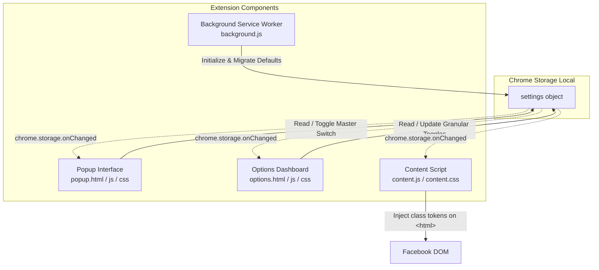

# Development & Architecture Documentation: FB Trim

This document details the internal design, architecture, performance strategies, and development guidelines for **FB Trim — Minimal Sidebar**.

---

## 1. Project Overview

**FB Trim** is a lightweight, high-performance Google Chrome extension (Manifest V3) designed to remove clutter, distractions, and unwanted navigational elements from Facebook's desktop web interface (specifically the left sidebar and top navigation bar).

### Core Goals
- **Zero Layout Shift (Zero-FOUC)**: Web pages should never flash unstyled or unwanted content before hiding them.
- **Maximum Performance**: Minimal CPU and memory overhead; CSS rules drive hiding rather than heavy JavaScript DOM manipulation.
- **Granular Control**: Independent toggles for every navigation item, paired with curated one-click defaults.
- **Resilience**: Adaptive selectors handling Facebook's dynamic class obfuscations and periodic DOM shifts.

---

## 2. System Architecture



### File Hierarchy

```text
fb-trim/
├── manifest.json              # Extension manifest (Manifest V3)
├── README.md                  # User-facing introduction & installation guide
├── Development.md             # Developer architecture & design documentation
├── icons/                     # Extension branding icons (16, 32, 48, 128px)
└── src/
    ├── background/
    │   └── background.js      # Service worker: installation & storage migration
    ├── content/
    │   ├── content.css        # Scoped CSS hiding rules keyed by root classes
    │   └── content.js         # Early root class applicator & dynamic item scanner
    ├── options/
    │   ├── options.html       # Granular settings dashboard
    │   ├── options.css        # Options UI styling (modern dark glassmorphism)
    │   └── options.js         # Settings manager & batch actions logic
    └── popup/
        ├── popup.html         # Compact extension toolbar popup
        ├── popup.css          # Popup dark mode theme & custom switch styles
        └── popup.js           # Master enable/disable toggle & options opener
```

---

## 3. Core Design Principles & Mechanisms

### 3.1 Zero-FOUC Injection Strategy

Traditional content scripts running at `document_idle` suffer from Flash of Unstyled Content (FOUC), where sidebars render momentarily before being hidden by JavaScript.

**FB Trim's Solution**:
1. `content_scripts` are registered with `"run_at": "document_start"`.
2. Both `content.css` and `content.js` are injected before any DOM nodes render.
3. `content.js` queries `chrome.storage.local` immediately and applies CSS token classes directly to `document.documentElement` (`<html>`):
   ```javascript
   root.classList.toggle('fb-diet-hide-left-gaming', isEnabled);
   ```
4. `content.css` hides items purely through descendant selectors:
   ```css
   html.fb-diet-hide-left-gaming div[role="navigation"] a[href*="/gaming/"] {
     display: none !important;
   }
   ```
This guarantees elements are invisible prior to their initial paint.

### 3.2 Dual-Layer Targeting: Static Selectors + Dynamic Scanner

Facebook heavily utilizes React with compiled, randomized class names (e.g. `x193iq5w xeuugli`). Static class targeting is inherently fragile.

FB Trim uses a dual-layer strategy:
1. **Primary Layer (Attribute & URL Matching)**:
   Matches persistent attributes such as `href*="/friends/"`, `href*="/marketplace/"`, SVG paths, or `aria-label` attributes.
2. **Secondary Layer (Dynamic Text Scanner)**:
   Asynchronous components like **Ads Manager** often load lazily under "See More" and embed ambiguous URLs.
   - `content.js` executes a throttled DOM scanner (`triggerThrottledScan`) utilizing `requestAnimationFrame`.
   - A `MutationObserver` on `document.documentElement` triggers the scanner whenever new subtrees are mounted without causing layout thrashing.
   - Nodes matching text identifiers (`廣告管理員`, `Ads Manager`) receive the `.fb-diet-hide-left-ads-manager-node` class.

---

## 4. State & Storage Architecture

All state is stored within `chrome.storage.local` under the `settings` key.

### Data Schema

```typescript
interface Settings {
  enabled: boolean;                      // Master switch

  // Left Sidebar items (Profile, Feeds, and Messenger are always shown / fixed)
  hideLeftFriends: boolean;
  hideLeftGroups: boolean;
  hideLeftMarketplace: boolean;
  hideLeftReels: boolean;
  hideLeftMemories: boolean;
  hideLeftSaved: boolean;
  hideLeftPages: boolean;
  hideLeftEvents: boolean;
  hideLeftGaming: boolean;               // default: true
  hideLeftMetaAI: boolean;               // default: true
  hideLeftAdsManager: boolean;           // default: true
  hideLeftRecentAdActivity: boolean;     // default: true
  hideLeftProfessionalDashboard: boolean;// default: true
  hideLeftMessengerKids: boolean;        // default: true
  hideLeftMetaQuest: boolean;            // default: true
  hideLeftFundraisers: boolean;          // default: true
  hideLeftOrdersPayments: boolean;       // default: true

  // Top Navigation items
  hideTopReels: boolean;
  hideTopMarketplace: boolean;
  hideTopGaming: boolean;                // default: true
}
```

### Real-Time Synchronization

- **Popup** and **Options Page**: Writing to `chrome.storage.local` immediately updates the shared state.
- **Content Script & Popup**: Both listen to `chrome.storage.onChanged`:
  ```javascript
  chrome.storage.onChanged.addListener((changes, area) => {
    if (area === 'local' && changes.settings) {
      // Re-apply tokens immediately without requiring a page refresh
    }
  });
  ```

---

## 5. UI Components

### 5.1 Popup (`src/popup/`)
- Minimal footprint (`width: 250px`).
- Displays branding, a clean **Enabled / Disabled master toggle** integrated into the right side of the header, and a direct link to open the full Options page.
- Status indicator text/dots are omitted to maintain an ultra-clean, modern aesthetic.

### 5.2 Options Page (`src/options/`)
- Full dashboard providing individual controls for 20 toggleable features.
- Essential core items (**Profile**, **Feeds**, **Messenger**) are marked with an **Always Shown** badge without toggles.
- Grouped into **Left Sidebar** and **Top Navigation**.
- **Quick Action Bar**:
  - `Recommended`: Reverts to curated clean defaults.
  - `Hide All`: Enables all hide rules for maximum minimalism.
  - `Show All`: Disables all hide rules.
- Master toggle in header disables all feature switches simultaneously with visual opacity feedback.

---

## 6. Maintenance & Extending FB Trim

### How to Add a New Item to Trim

1. **Add CSS rule in `src/content/content.css`**:
   ```css
   html.fb-diet-hide-left-newitem div[role="navigation"] a[href*="/newitem/"] {
     display: none !important;
   }
   ```

2. **Add default setting in `src/background/background.js` and `src/options/options.js`**:
   ```javascript
   hideLeftNewItem: true // or false
   ```

3. **Add switch to `src/options/options.html`**:
   ```html
   <div class="feature-item">
     <div class="feature-meta">
       <span class="feature-icon">✨</span>
       <div class="feature-title">New Item Name</div>
     </div>
     <label class="switch">
       <input type="checkbox" id="hideLeftNewItem">
       <span class="slider round"></span>
     </label>
   </div>
   ```

4. **Verify naming convention**:
   `content.js` automatically maps camelCase keys (e.g. `hideLeftNewItem`) to CSS class names (`fb-diet-hide-left-new-item`) via regex:
   ```javascript
   function getUiCleanClassName(key) {
     if (key === 'hideLeftMetaAI') return 'fb-diet-hide-left-metaai';
     return 'fb-diet-' + key.replace(/([A-Z])/g, '-$1').toLowerCase();
   }
   ```
